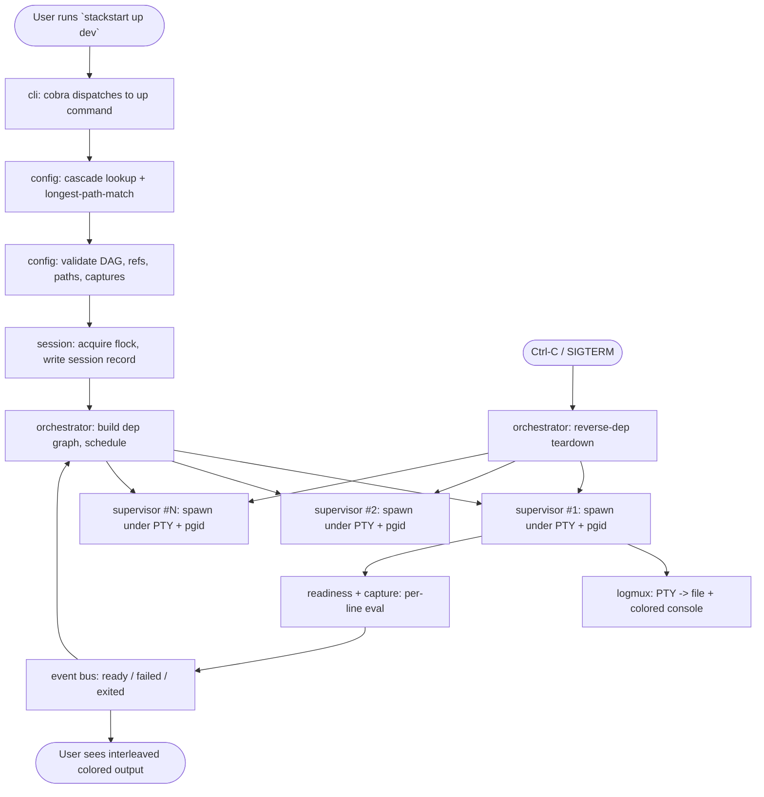
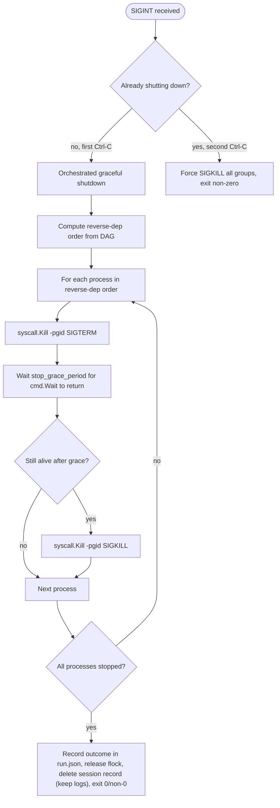

<!-- Stackstart - https://github.com/orpic/stack-start -->
<!-- Copyright (c) 2026 Shobhit. All rights reserved. See LICENSE. -->

# Stackstart - Technical Design

This document is the implementation-side companion to [PRD.md](PRD.md). The PRD defines **what** stackstart is and **what** it must do; this document defines **how** the v1 binary is built in Go.

Reading order: skim sections 1-2 for the high-level shape; sections 3-4 for project layout and dependencies; sections 5-6 for the user-facing schema and reference syntax; sections 7-12 for the runtime (lookup, supervision, readiness, env, IPC, logging); sections 13-15 for CLI / testing / release.

---

## 1. Purpose & relationship to PRD

- **PRD.md** is the contract. It enumerates functional requirements (F1-F11) and non-functional requirements (NFR1-NFR7) that v1 must satisfy.
- **TECH.md** (this document) specifies the architecture, package structure, libraries, algorithms, and on-disk schemas that implement the PRD.
- When the two documents disagree, the PRD wins. If a PRD requirement turns out to be infeasible during implementation, the PRD is amended first; this document is updated second.
- A small number of PRD-deferred decisions (config format, exact reference syntax, etc.) are finalized in this document; those finalizations are noted inline as "**locks PRD section X**."

## 2. High-level architecture

A single static Go binary (`stackstart`) that does three things sequentially when you run `stackstart up <name>`:

1. **Resolve** - find the right profile in the right `stackstart.yaml` for the current cwd.
2. **Validate** - parse it, check the dependency DAG, check capture references, check path constraints.
3. **Orchestrate** - spawn each process under a supervisor goroutine, wait for readiness in dependency order, propagate captured values into dependents' environments, stream logs to console + per-process log files, handle Ctrl-C with a graceful tear-down.



Concurrency model:

- The CLI runs in the main goroutine; the orchestrator runs in a goroutine spawned from `up`.
- Each supervised process gets its own goroutine for `cmd.Wait()` plus another for log multiplexing (one goroutine per child reading from the PTY master fd).
- A central `events` channel carries per-process state transitions; the orchestrator reads it and decides which dependents are now eligible to start.
- Everything is rooted in a single `context.Context` derived from the `up` invocation. Ctrl-C cancels the root context; downstream goroutines respect cancellation and exit cleanly.

## 3. Stack & dependencies

Stackstart vendors a deliberately small dependency surface. Every dep below is justified inline; we reject anything that would pull in transitive complexity beyond what its narrow job needs.

- **`github.com/spf13/cobra`** - CLI framework. Industry standard for Go CLIs (kubectl, gh, hugo). Provides subcommands, flag parsing, generated help, and shell completion. Pulls in `spf13/pflag`. Stable, well-maintained.
- **`gopkg.in/yaml.v3`** - YAML parser. The canonical Go YAML library. Supports comments, anchors, and the strictness we need for clear error messages.
- **`github.com/creack/pty`** - PTY (pseudo-terminal) creation for child processes. Tiny dependency, single-purpose, used by ttyd, gotty, and most Go process supervisors.
- **`github.com/fatih/color`** - ANSI color output for the interleaved console writer. Tiny, well-tested. Alternative considered: `charmbracelet/lipgloss` (rejected: bigger, geared toward TUIs which we explicitly are not building in v1).
- **`log/slog`** (stdlib, Go 1.21+) - structured logging for stackstart's own diagnostic logs (NOT child process output). Zero external dep. Defaults to a JSON handler in CI / `--log-format=json`, text handler for interactive use.
- **`text/template`** (stdlib) - file template rendering for the optional `templates:` block on processes. Stdlib-only.
- **`syscall`** (stdlib) - process group setup (`Setpgid`), file locking (`Flock`), signal sending. Platform-specific code lives behind build tags (see section 8).

Build / dev tooling (not vendored at runtime):

- **`golangci-lint`** - aggregated linter (errcheck, govet, ineffassign, staticcheck, gosimple, unused, gofmt). Enforced in CI.
- **`goreleaser`** - cross-platform release pipeline (binaries + GitHub Release + Homebrew formula).

There is **no** runtime dependency on Docker, container runtimes, system shells beyond `/bin/sh` for executing `cmd:` strings, terminal emulators, or any database. The only **soft** runtime dependency is `direnv`, used only when a profile's project tree contains a `.envrc` file.

## 4. Project layout

The repository follows the standard Go CLI layout: a thin `cmd/` entrypoint and a fat `internal/` tree of single-purpose packages. Everything under `internal/` is private to this module by Go's `internal/` convention - no external project can import it.

```
stack-start/
  cmd/
    stackstart/
      main.go                  # entrypoint - parses build-time version vars,
                               # constructs root cobra command, runs it
  internal/
    cli/                       # one file per subcommand
      root.go                  # root cobra command + global flags
      up.go                    # `stackstart up <profile>`
      down.go                  # `stackstart down [--profile <name>]`
      logs.go                  # `stackstart logs <process> [--profile <name>]`
      status.go                # `stackstart status`
      list.go                  # `stackstart list`
      init.go                  # `stackstart init` (scaffolds a starter YAML)
      validate.go              # `stackstart validate <profile>`
    config/                    # YAML schema + parser + profile resolver
      schema.go                # Go structs that mirror the YAML schema
      parse.go                 # yaml.v3 unmarshalling + structural validation
      validate.go              # semantic validation (DAG, paths, refs, captures)
      resolve.go               # cascade walk + longest-path-match algorithm
      testdata/                # fixture YAML files
    env/                       # environment composition
      envrc.go                 # direnv shellout + native plain-export parser
      dotenv.go                # .env file parser
      compose.go               # apply precedence: shell -> envrc -> .env -> per-process -> captures
    interpolate/               # ${producer.name} resolver for env values and cmd strings
      lex.go                   # tokenize ${...} occurrences
      resolve.go               # resolve against capture map + envrc map
    template/                  # text/template wrapper for file rendering
      render.go                # render src -> dst with capture/envrc data
    supervisor/                # process spawn, PTY, pgid, signal handling
      supervisor.go            # high-level lifecycle (start, watch, stop)
      pty_unix.go              # creack/pty spawn under build tag `unix`
      pgid_unix.go             # SysProcAttr Setpgid + group signal helpers
      signal.go                # graceful stop / force kill of a whole process tree
    output/                    # PTY bytes -> sanitized lines
      reader.go                # unlimited line reader, partial-line flush, raw tee
      sanitize.go              # \r handling, escape-code stripping, clear detection
    proctree/                  # descendants by parent PID (/proc or ps)
      proctree.go
    readiness/                 # readiness check implementations
      check.go                 # Check interface + result types
      log_regex.go             # log-regex check
      tcp_port.go              # TCP-port check
      evaluator.go             # multi-check AND/OR evaluator + timeout enforcement
    capture/                   # capture engine
      capture.go               # Capture struct, regex compilation, scanner integration
      registry.go              # in-memory map of {producer -> {name -> value}}
    session/                   # cross-shell session record + locking
      record.go                # session JSON schema + read/write
      lock.go                  # flock acquire/release
      reap.go                  # stale-record GC (PID-not-alive cleanup), session matching
      runs.go                  # per-run directories, run.json, retention, MatchesProject
      paths.go                 # XDG_STATE_HOME path resolution
    logmux/                    # sanitized lines -> plain log file + colored console
      mux.go                   # writer for lines and [stackstart] marker lines
      color.go                 # stable per-process color assignment
      prefix.go                # "<name> | <line>" formatting
    tail/                      # native log-file tailing for `stackstart logs`
      tail.go                  # open + seek + poll (handles file truncation)
    version/                   # build-time version info
      version.go               # vars set via -ldflags at build time
  conformance/                 # the test suite (black-box, see section 14)
    CONTRACT.md                # everything cases may rely on
    README.md                  # case format and how to run
    MIGRATION.md               # where each removed Go test is now covered
    cases/<area>/<case>/       # case.yaml + stackstart.yaml + files
    runner/                    # separate Go module that runs the cases
  test-projects/               # real apps (Phoenix, Django, ...) used by cases
  .github/
    workflows/
      ci.yaml                  # lint + conformance (every push), full suite nightly
      release.yaml             # tag push: goreleaser release
  .goreleaser.yaml             # release pipeline config
  .golangci.yaml               # linter config
  go.mod
  go.sum
  PRD.md
  TECH.md
  README.md
  PROBLEM_STATEMENT.md
```

- **Module path**: `github.com/orpic/stack-start`
- **Binary name**: `stackstart` (no hyphen)
- **Repo name**: `stack-start` (matches the workspace dir; this is fine and common in Go - the binary name is decided by the directory under `cmd/`)

## 5. Configuration: schema & format

### 5.1 Format

YAML, parsed via `gopkg.in/yaml.v3`. **Locks PRD section 14's "config file format" open question.**

Filename: `stackstart.yaml` (visible, no leading dot - matches PRD F-section).

### 5.2 Top-level structure

A `stackstart.yaml` file contains one or more **profiles**. Each profile contains a map of **processes**. There is no other top-level construct.

```yaml
profiles:
  <profile_name>:
    project_path: <absolute path>          # required only in ~/stackstart.yaml;
                                           # implicit (file's directory) for project-local files
    processes:
      <process_name>:
        kind: oneshot | long-running       # optional, default: long-running
        cwd: <relative path>               # required, relative to project_path
        cmd: <shell command string>        # required
        env:                               # optional
          <KEY>: <value with ${...} refs>
        depends_on: [<process_name>, ...]  # optional
        readiness:                         # optional; if omitted, dependents start on spawn
          timeout: <duration>              # required if `readiness` block exists
          mode: any | all                  # optional, default: all
          checks:                          # required if `readiness` block exists
            - log: <regex>                 # OR
            - tcp: <host:port>             # OR
            - capture: <capture name>      # ready once that capture has a value
        captures:                          # optional
          - name: <identifier>
            log: <regex with capture group>
            required: true | false         # optional, default: true
        fail_on: [<regex>, ...]            # optional; during startup a match fails the
                                           # process at once; after ready it is a warning
        templates:                         # optional
          - src: <relative path>
            dst: <relative path>
        on_exit: fail | ignore             # optional, default: fail
        required: true | false             # optional, default: true
        stop_grace_period: <duration>      # optional, default: 10s
```

### 5.3 Path semantics (share-friendly design)

This is the **key portability property** of stackstart: a `stackstart.yaml` committed to a repo is fully portable across teammates.

- The **profile-level `project_path`** field is the only place an absolute path is permitted - and only in `~/stackstart.yaml`. In a project-local `stackstart.yaml` it is implicit (= the file's directory) and **must not** be written explicitly.
- **Every** path field nested inside a process declaration (`cwd`, template `src`, template `dst`, any future path-bearing field) **MUST** be relative to the profile's `project_path`. Absolute paths are rejected at validation with a clear error.
- This means: Alice clones to `/Users/alice/code/onepiece`, Bob clones to `/Users/bob/work/onepiece`, both run the exact same `stackstart.yaml`, and everything resolves correctly because nothing inside the file is hardcoded to either machine.
- `stackstart init` scaffolds a `stackstart.yaml` already conformant to this rule.

### 5.4 Realistic full example

```yaml
profiles:
  dev:
    processes:
      postgres:
        cwd: packages/db
        cmd: docker compose up postgres
        readiness:
          timeout: 30s
          checks:
            - tcp: localhost:5432

      cloudflared:
        cwd: packages/tunnel
        cmd: cloudflared tunnel --url http://localhost:4000
        readiness:
          timeout: 20s
          checks:
            - log: "https://[a-z0-9-]+\\.trycloudflare\\.com"
        captures:
          - name: url
            log: "(https://[a-z0-9-]+\\.trycloudflare\\.com)"
            required: true

      backend:
        cwd: packages/backend
        cmd: npm run dev
        depends_on: [postgres, cloudflared]
        env:
          TUNNEL_URL: "${cloudflared.url}"
          DATABASE_URL: "${envrc.DATABASE_URL}"
        readiness:
          timeout: 60s
          checks:
            - log: "listening on port 4000"

      web:
        cwd: packages/web
        cmd: npm run dev
        depends_on: [backend]
        on_exit: ignore
        templates:
          - src: packages/web/runtime-config.json.tmpl
            dst: packages/web/runtime-config.json
        readiness:
          timeout: 30s
          checks:
            - tcp: localhost:3000

  minimal:
    processes:
      postgres:
        cwd: packages/db
        cmd: docker compose up postgres
        readiness:
          timeout: 30s
          checks:
            - tcp: localhost:5432
      backend:
        cwd: packages/backend
        cmd: npm run dev
        depends_on: [postgres]
        readiness:
          timeout: 60s
          checks:
            - log: "listening on port 4000"
```

### 5.5 Go schema types (sketch)

```go
// internal/config/schema.go
package config

import "time"

type File struct {
    Profiles map[string]Profile `yaml:"profiles"`
}

type Profile struct {
    ProjectPath string             `yaml:"project_path,omitempty"`
    Processes   map[string]Process `yaml:"processes"`
}

type Process struct {
    Kind            string            `yaml:"kind,omitempty"`            // "oneshot" | "long-running"
    Cwd             string            `yaml:"cwd"`
    Cmd             string            `yaml:"cmd"`
    Env             map[string]string `yaml:"env,omitempty"`
    DependsOn       []string          `yaml:"depends_on,omitempty"`
    Readiness       *Readiness        `yaml:"readiness,omitempty"`
    Captures        []Capture         `yaml:"captures,omitempty"`
    Templates       []Template        `yaml:"templates,omitempty"`
    OnExit          string            `yaml:"on_exit,omitempty"`        // "fail" | "ignore"
    Required        *bool             `yaml:"required,omitempty"`
    StopGracePeriod time.Duration     `yaml:"stop_grace_period,omitempty"`
}

type Readiness struct {
    Timeout time.Duration `yaml:"timeout"`
    Mode    string        `yaml:"mode,omitempty"` // "any" | "all"; default "all"
    Checks  []Check       `yaml:"checks"`
}

type Check struct {
    Log string `yaml:"log,omitempty"` // regex
    TCP string `yaml:"tcp,omitempty"` // host:port
}

type Capture struct {
    Name     string `yaml:"name"`
    Log      string `yaml:"log"` // regex with one capture group
    Required *bool  `yaml:"required,omitempty"` // default true
}

type Template struct {
    Src string `yaml:"src"`
    Dst string `yaml:"dst"`
}
```

## 6. Reference & templating syntax

Two distinct syntaxes, used in two distinct contexts. **Locks PRD section 14's "exact reference syntax" open question.**

### 6.1 `${producer.name}` for env values and cmd strings

Used inside `env:` map values and inside `cmd:` strings. Resolved by stackstart's own small interpolation pass in `internal/interpolate/`.

Producers:

- **Capture references**: `${<process>.<capture_name>}` - e.g. `${cloudflared.url}` resolves to the value captured by the `url` capture on the `cloudflared` process. Resolved at the moment the consuming process starts (which is guaranteed to be after the producer is ready, hence after its required captures have completed).
- **Envrc references**: `${envrc.<VARNAME>}` - e.g. `${envrc.DATABASE_URL}` resolves to the value of `DATABASE_URL` in the resolved `.envrc` environment for the project (see section 10).

Escape: a literal `$` is written `$$`.

Example:

```yaml
backend:
  cmd: "./server --tunnel=${cloudflared.url} --db=${envrc.DATABASE_URL}"
  env:
    TUNNEL_URL: "${cloudflared.url}"
    DOLLAR_LITERAL: "$$50"   # resolves to literal "$50"
```

### 6.2 Go `text/template` syntax inside template files

Used inside files that stackstart renders before a dependent starts (the `templates: [{src, dst}]` block on a process). Resolved by `text/template` from the stdlib.

Inside a template file, both captures and envrc values are accessible via dotted paths on the template data root:

```text
{{ .cloudflared.url }}
{{ .envrc.DATABASE_URL }}
```

The data context passed to the template is a Go `map[string]any` of the form:

```go
{
    "cloudflared": map[string]any{"url": "https://random-words.trycloudflare.com"},
    "envrc":       map[string]any{"DATABASE_URL": "postgres://..."},
}
```

Standard `text/template` features (`{{ if }}`, `{{ range }}`, etc.) are available but not required; v1 documentation will only show simple `{{ .x.y }}` substitution. Loops and conditionals are not opinionated against - they just work because we're using stdlib.

### 6.3 Why two syntaxes

- `${...}` reads naturally inside YAML strings (`"${x.y}"`) and in shell-style `cmd:` strings; using `{{ }}` there would force ugly `"{{ .x.y }}"`.
- `{{ }}` is the native Go template syntax for files; using `${}` there would mean writing our own template engine for files, doubling the surface area for marginal consistency benefit.

This is a trade-off acknowledged once in the docs and never asked about again.

## 7. Profile lookup algorithm

Lookup is a pure function of `(cwd, profile_name)`. There is **no merging** across files. **Locks PRD F5.**

```go
// pseudocode in internal/config/resolve.go

func Resolve(cwd, name string, home string) (Profile, FilePath, error) {
    candidates := []candidate{}

    // 1. Walk from cwd upward to filesystem root, collecting matches
    for dir := cwd; dir != "/" && dir != ""; dir = filepath.Dir(dir) {
        path := filepath.Join(dir, "stackstart.yaml")
        if file, err := readFile(path); err == nil {
            for _, p := range file.Profiles {
                if p.Name == name {
                    // Project-local: project_path implicit = file's directory
                    pp := p.ProjectPath
                    if pp == "" {
                        pp = dir
                    }
                    if isWithinOrEqual(cwd, pp) {
                        candidates = append(candidates, candidate{p, path, pp})
                    }
                }
            }
        }
    }

    // 2. Consult ~/stackstart.yaml last
    userPath := filepath.Join(home, "stackstart.yaml")
    if file, err := readFile(userPath); err == nil {
        for _, p := range file.Profiles {
            if p.Name == name && p.ProjectPath != "" && isWithinOrEqual(cwd, p.ProjectPath) {
                candidates = append(candidates, candidate{p, userPath, p.ProjectPath})
            }
        }
    }

    if len(candidates) == 0 {
        return Profile{}, "", ErrNoMatchingProfile
    }

    // 3. Tie-break: longest project_path wins (handles nested projects)
    sort.Slice(candidates, func(i, j int) bool {
        return len(candidates[i].projectPath) > len(candidates[j].projectPath)
    })

    return candidates[0].profile, candidates[0].file, nil
}
```

Notes:

- The walk stops at the filesystem root. We do NOT walk past `/`.
- A project-local `stackstart.yaml` MUST NOT contain a `project_path:` field; if it does, it's a validation error (see section 5.3 - portability).
- A user-level `~/stackstart.yaml` profile MUST contain `project_path:`; missing it makes the profile invisible to the lookup (also a validation warning).
- "Within or equal" means filepath-prefix match at directory boundaries. `/a/b/c` is within `/a/b` but not within `/a/bx`.

## 8. Process supervision

This is the runtime core. Each process declared in a profile gets a `Supervisor` instance.

### 8.1 PTY spawn

Each child is spawned attached to a PTY, not pipes. Reasoning: child processes that detect a TTY (npm, cargo, vite, anything using `isatty`) emit ANSI color and use line-buffered output by default - exactly what we want. Pipes would require setting `FORCE_COLOR=1` / `CLICOLOR_FORCE=1` / `TERM=xterm-256color` in the child env and hoping each tool honors them, which not all do.

Trade-off: a single PTY merges stdout and stderr. **Locks PRD F2.1**: in v1, log-regex readiness checks scan the merged stream; the per-check `stream:` selector is removed (always "both"). This is a documented amendment to PRD section 6 and F2.1 (see section 16 of this doc).

```go
// internal/supervisor/pty_unix.go
//go:build unix

package supervisor

import (
    "os/exec"
    "syscall"

    "github.com/creack/pty"
)

func spawnPTY(cmd *exec.Cmd) (ptyMaster *os.File, err error) {
    cmd.SysProcAttr = &syscall.SysProcAttr{
        Setpgid: true,   // own process group; see section 8.2
    }
    return pty.Start(cmd)
}
```

Windows is explicitly out of v1; the `pty_unix.go` build tag is the only PTY implementation we ship.

### 8.2 Process group (pgid) for clean kill

Every child runs in its own process group via `SysProcAttr{Setpgid: true}`. This means when the child forks grandchildren (e.g. `npm run dev` -> `node` + `webpack` + `vite`), they all join the same group.

To shut a process down cleanly we send signals to the **process group**, not just the direct PID:

```go
// internal/supervisor/pgid_unix.go
//go:build unix

func signalGroup(pid int, sig syscall.Signal) error {
    // Negative PID = "send to entire process group"
    return syscall.Kill(-pid, sig)
}
```

This is the difference between "node and webpack die when you Ctrl-C" and "node dies but webpack lingers as a zombie eating a port" - a real source of pain in hand-rolled supervisors.

The group is not the whole tree, though. Children can leave it: the BEAM starts every port program (Phoenix's esbuild and tailwind watchers) through `erl_child_setup` in a new process group, and anything that calls `setsid` or daemonises does the same. Before signalling, stackstart therefore snapshots the process's descendants by parent PID (`internal/proctree`: `/proc` on Linux, `ps` elsewhere). Descendants outside the group get the same SIGTERM, share the grace period, and get SIGKILL with the group. The snapshot has to come first: once their parent exits they are re-parented to PID 1 and can no longer be traced.

### 8.3 Lifecycle states

A supervised process moves through these states, written into the per-process state file (see section 11):

- `pending` - declared in the profile, dependencies not yet ready
- `starting` - spawned, PTY attached, readiness checks running
- `ready` - all readiness checks passed, all required captures resolved. For oneshot processes: exited with code 0 (and checks satisfied if any were defined).
- `failed` - readiness timed out, capture missed, exited during readiness wait, or (for oneshot) exited with non-zero code.
- `exited` - exited cleanly post-ready (with `on_exit: ignore`). Not used for oneshot processes.

State transitions are emitted onto the central `events` channel; the orchestrator reacts to `ready` events to release dependents. For oneshot processes, the `ready` event is emitted only from the wait loop (after exit code is known), never from the scan loop.

`up` ends with exit 0 once every process has finished: exited, failed while not required, or a oneshot that completed. A profile made only of oneshots (migrate, then seed) therefore runs to completion and exits instead of waiting forever.

### 8.4 Signal handling and orchestrated shutdown

Stackstart catches SIGINT (Ctrl-C) and SIGTERM in the main process. It does NOT let the kernel propagate the signal to children directly - because each child is in its own process group, the kernel's foreground-process-group signal delivery doesn't reach them, which is exactly what we want: stackstart owns the shutdown choreography.

Shutdown flow on Ctrl-C:



The double-Ctrl-C escape is critical UX: if a child ignores SIGTERM (broken signal handler, infinite loop in shutdown hook), the user can press Ctrl-C again to force-kill everything immediately rather than wait out N processes' worth of `stop_grace_period`. The second signal SIGKILLs every process group and escaped descendant before stackstart exits with 130; exiting alone would orphan them, because children run in their own sessions and never receive the terminal's signals.

SIGHUP (the terminal window was closed) is handled like SIGTERM. Go's default for SIGHUP is to exit, which would leave the whole stack running with nobody supervising it.

Any process that is still alive is stopped during shutdown, whatever its state. In particular, a process that failed its readiness check is usually still running and must be stopped too.

### 8.5 Shutdown ordering

Shutdown runs in **reverse dependency order**. If the dep DAG was `db <- backend <- web`, shutdown order is `web`, then `backend`, then `db`. This minimizes "downstream still-running processes hammering an already-dead upstream" log noise during shutdown.

In practice the per-process shutdowns kick off in parallel within each "layer" of the reverse-dep order, with a brief wait between layers. Implementation detail; the user never sees this complexity.

## 9. Readiness & capture engine

Readiness checks and captures both operate on the **merged PTY output stream** of a single process. They are evaluated together, per line, by a single line scanner per process.

### 9.1 Output reader and readiness loop

Each supervisor runs three goroutines: an output pump, a readiness loop, and a wait loop.

**Output pump** (`internal/output`). Reads the PTY until it closes and **never stops early**: a process whose output is not drained blocks on its next write. It replaced a `bufio.Scanner`, whose 64 KB line limit silently stopped all reading (and froze the process) on the first long line. The reader:

- tees every byte, unmodified, to `<process>.raw.log`;
- splits lines on `\n` and emits lines longer than 64 KB in chunks;
- flushes an unfinished line after 250 ms of silence, so prompts that never end in a newline (`iex(1)> `, `Ok to proceed? (y) `) reach readiness checks, captures and the log;
- sanitizes each line (`output.Sanitize`): resolves `\r` the way a terminal would (CRLF, spinner frames), removes every escape sequence for the plain text, and keeps only colors (SGR) for the console. Screen clears (`ESC[2J`, `ESC[3J`, `ESC c`) are reported as `Cleared`.

Per line, the supervisor writes a `[stackstart] screen cleared` marker if the line cleared the screen, writes the line, then (until settled) evaluates log checks, captures and `fail_on` against the **plain text**, and finally tries to become ready synchronously, so a ready line is always reported before an exit that follows it.

**Readiness loop.** Re-evaluates readiness every 100 ms, so background checks (`tcp:`) pass for processes that go silent, and fails the process when the timeout expires whatever the process is doing. Previously the timeout was only noticed when output stopped, so a process that kept logging, or went silent, stayed in `starting` forever.

The startup outcome (ready, or failed before ready) is decided exactly once (`settled` compare-and-swap) by whichever of the pump, readiness loop or wait loop gets there first.

### 9.2 Readiness check types

#### `log: <regex>`

Per-line, unanchored substring match (`grep` semantics). Compiled once with `regexp.MustCompile`. Matches against the line's plain text (escape codes removed, `\r` resolved), so `^downloaded$` matches a line whose raw bytes are `30%\r\x1b[Kdownloaded`.

```go
type LogRegexCheck struct {
    Pattern *regexp.Regexp
    matched atomic.Bool
}

func (c *LogRegexCheck) Evaluate(line []byte) {
    if c.matched.Load() {
        return
    }
    if c.Pattern.Match(line) {
        c.matched.Store(true)
    }
}

func (c *LogRegexCheck) Satisfied() bool { return c.matched.Load() }
```

#### `tcp: <host:port>`

Periodically attempts a TCP connection. A check is satisfied the first time `net.DialTimeout("tcp", "host:port", 1s)` returns nil error.

The TCP poller runs as a separate goroutine for each TCP check, polling at a small fixed interval (200ms is the implementation default, not user-configurable in v1). It exits as soon as one connection succeeds or the readiness timeout expires.

```go
type TCPCheck struct {
    Address string
    matched atomic.Bool
}

func (c *TCPCheck) Run(ctx context.Context) {
    ticker := time.NewTicker(200 * time.Millisecond)
    defer ticker.Stop()
    for {
        select {
        case <-ctx.Done():
            return
        case <-ticker.C:
            conn, err := net.DialTimeout("tcp", c.Address, time.Second)
            if err == nil {
                conn.Close()
                c.matched.Store(true)
                return
            }
        }
    }
}
```

#### `capture: <name>`

Satisfied once the named capture of the same process has a value. Use it instead of a `log:` check that repeats the capture's regex: one regex to get right instead of two.

#### `fail_on: [<regex>, ...]`

Not a readiness check but evaluated alongside them. During startup, the first line matching any pattern fails the process immediately with `matched fail_on /<pattern>/: <line>`, instead of waiting for the timeout. After the process is ready, a match writes a `[stackstart] warning: matched fail_on ...` marker and the stack keeps running.

### 9.3 Mode evaluation

A process's `readiness.checks` is evaluated as either `all` (every check satisfied) or `any` (at least one check satisfied), per the `readiness.mode` field. Default is `all`.

```go
func (e *Evaluator) Satisfied() bool {
    if e.Mode == "any" {
        for _, c := range e.Checks {
            if c.Satisfied() {
                return true
            }
        }
        return false
    }
    // mode == "all"
    for _, c := range e.Checks {
        if !c.Satisfied() {
            return false
        }
    }
    return true
}
```

### 9.4 Mandatory timeout

`readiness.timeout` is a required field (no default). The evaluator runs under a `context.WithTimeout(parent, timeout)`. When the context expires:

- The process is marked `failed` with attribution: which check(s) had not yet satisfied, e.g. `readiness timeout after 30s; still waiting for tcp 127.0.0.1:5432`. The process is left running for the orchestrator to stop.
- The orchestrator triggers an orchestrated shutdown of the whole stack (per `on_exit: fail` default).

### 9.5 Captures

A capture has a name, a regex with exactly one capturing group (parens), and a `required` flag (default true).

```go
type Capture struct {
    Name     string
    Pattern  *regexp.Regexp
    Required bool
    captured atomic.Pointer[string]
}

func (c *Capture) Match(line []byte) (bool, string) {
    if c.captured.Load() != nil {
        return false, ""
    }
    sub := c.Pattern.FindSubmatch(line)
    if len(sub) < 2 {
        return false, ""
    }
    val := string(sub[1])
    c.captured.Store(&val)
    return true, val
}
```

Validation rejects captures whose regex has zero or more than one capturing group.

A process is **not** considered ready until all `required: true` captures have completed, even if the readiness checks themselves pass first. This is what guarantees dependents never see a missing capture - section 9.1's `allRequiredCapturesDone() && readinessSatisfied()` predicate.

Captured values are stored in an in-memory registry (`internal/capture/registry.go`) keyed by `(process_name, capture_name)`. Dependents reference values via `${producer.name}` (env/cmd) or `{{ .producer.name }}` (templates), resolved at the moment the consuming process starts.

## 10. Environment composition

A process's effective environment is computed once, at the moment of spawn, by composing five layers in increasing precedence (later layers override earlier on key collision):

1. **Inherited shell env** - the entire `os.Environ()` at the time `stackstart up` was invoked, then the non-interactive defaults `PAGER=cat`, `GIT_PAGER=cat`, `PSQL_PAGER=cat`, `MANPAGER=cat`, `SYSTEMD_PAGER=` (`env.NonInteractiveDefaults`). Processes run on a terminal nobody types into; without these, `psql` or `git log` in a oneshot opens `less` and waits forever at `(END)`. Later layers can override them.
2. **`.envrc` resolved env** - if a `.envrc` exists at `project_path` or any ancestor up to `project_path`. See section 10.1.
3. **`.env` file** - if `<project_path>/.env` exists. Plain `KEY=value` parser.
4. **Per-process `env:` block** - the YAML map. Values may contain `${producer.name}` and `${envrc.VAR}` references, resolved here.
5. **Resolved capture references** - any `${producer.name}` references in step 4 are substituted with their current captured values.

### 10.1 `.envrc` handling

`.envrc` files are direnv's domain. Two paths, decided at startup:

- **If `direnv` is on `PATH`**: shell out to `direnv exec <project_path> env -0`. Parse the NUL-separated `KEY=value` output. This handles all direnv directives correctly (`source_up`, `dotenv`, `layout`, `use`, conditionals, subshells).
- **If `direnv` is NOT on `PATH`**: stackstart's native parser is used. It accepts a strict subset only:
  - `export VAR=value`
  - `export VAR="quoted value"`
  - `export VAR='single-quoted'`
  - blank lines
  - `# comments`
  
  Anything else (`source_up`, `dotenv`, `if [...]`, `$(...)`, etc.) is a hard error: `"this .envrc requires direnv to evaluate; install direnv via 'brew install direnv' and run 'direnv allow'"`.

### 10.2 `.env` handling

Stackstart's own minimal parser. Lines look like `KEY=value` or `KEY="quoted value"`. Comments with `#`. No `export ` prefix expected (this is `.env`, not `.envrc`). No directives or expressions.

### 10.3 Composition pseudocode

```go
// internal/env/compose.go
func Compose(p Profile, proc Process, captures CaptureRegistry) ([]string, error) {
    envMap := map[string]string{}

    // Layer 1: inherited shell env
    for _, kv := range os.Environ() {
        k, v := splitKV(kv)
        envMap[k] = v
    }

    // Layer 2: .envrc
    if envrcEnv, err := loadEnvrc(p.ProjectPath); err == nil {
        for k, v := range envrcEnv {
            envMap[k] = v
        }
    }

    // Layer 3: .env
    if dotenv, err := loadDotenv(filepath.Join(p.ProjectPath, ".env")); err == nil {
        for k, v := range dotenv {
            envMap[k] = v
        }
    }

    // Layer 4 + 5: per-process env with reference resolution
    refData := buildRefData(captures, envMap) // exposes envrc.VAR + producer.name
    for k, v := range proc.Env {
        resolved, err := interpolate.Resolve(v, refData)
        if err != nil {
            return nil, fmt.Errorf("env %s: %w", k, err)
        }
        envMap[k] = resolved
    }

    return mapToSlice(envMap), nil
}
```

## 11. Cross-shell IPC

Stackstart has no daemon. To make `down`, `logs`, and `status` work from a shell other than the one running `up`, we use **file-based discovery** under XDG state.

### 11.1 Paths

```
$XDG_STATE_HOME/stackstart/                       # default: ~/.local/state/stackstart
  sessions/
    <slug>.json                                   # session record (only while running)
    <slug>.lock                                   # flock target (only while running)
    <slug>/                                       # per-session subdir, kept after exit
      latest -> runs/<run-id>                     # newest run
      runs/
        <run-id>/                                 # one per `up`, e.g. 20261010-221157-4242
          run.json                                # the record, plus outcome / failed_process / cause
          <process>.log                           # plain text: escape codes removed, \r resolved
          <process>.raw.log                       # exact bytes the process wrote
          <process>.state                         # one file per supervised process
          stackstart.log                          # orchestrator's own diag log (slog output)
```

Run directories outlive the session, so logs can be read after a crash. The newest 10 runs per session are kept (`session.DefaultKeepRuns`); older ones are pruned when a new run starts, and `stackstart clean` removes finished runs on demand.

`<slug>` is human-readable: `<project_path_with_slashes_to_underscores>__<profile_name>`. Example: `Users_shobhit_code_onepiece__dev`. This makes `ls ~/.local/state/stackstart/sessions/` immediately legible.

XDG resolution: respect `$XDG_STATE_HOME` if set; otherwise default to `~/.local/state` (Linux) and `~/Library/Application Support` (macOS - macOS doesn't have a true XDG state convention, so we follow a sensible analogue).

### 11.2 Session record schema

```json
{
  "slug": "Users_shobhit_code_onepiece__dev",
  "profile": "dev",
  "project_path": "/Users/shobhit/code/onepiece",
  "config_file": "/Users/shobhit/code/onepiece/stackstart.yaml",
  "stackstart_pid": 41234,
  "stackstart_version": "0.1.0",
  "run_id": "20260425-183000-41234",
  "started_at": "2026-04-25T18:30:00+05:30",
  "outcome": "running",
  "log_dir": "/Users/shobhit/.local/state/stackstart/sessions/Users_shobhit_code_onepiece__dev/runs/20260425-183000-41234",
  "processes": [
    {"name": "postgres", "pid": 41235, "log_file": ".../postgres.log", "raw_log_file": ".../postgres.raw.log", "state_file": ".../postgres.state"},
    {"name": "backend",  "pid": 41237, "log_file": ".../backend.log",  "raw_log_file": ".../backend.raw.log",  "state_file": ".../backend.state"}
  ]
}
```

The record is written atomically when the run starts and rewritten whenever a process starts, so `pid` is always the real PID (0 only for processes not started yet). The same record is kept as `run.json` in the run directory. When the run ends, `run.json` gets `ended_at`, `outcome` (`stopped` or `failed`) and, for failures, `failed_process` and `cause`. A run.json still saying `running` whose `stackstart_pid` is dead means stackstart itself was killed.

### 11.3 Per-process state files

Tiny single-line JSON updated on each transition:

```json
{"state":"ready","since":"2026-04-25T18:30:14+05:30","pid":41236}
```

Possible `state` values: `pending`, `starting`, `ready`, `failed`, `exited` (matching section 8.3).

Atomic writes: write to `<process>.state.tmp`, `os.Rename` to `<process>.state`. Readers may briefly miss a transition; this is acceptable for `status` polling.

### 11.4 Locking (`flock`)

On `up`:

1. Open `<slug>.lock` with `O_CREAT|O_RDWR`.
2. `syscall.Flock(fd, LOCK_EX|LOCK_NB)`. If it fails with `EWOULDBLOCK`, error with `"profile <name> is already running for project <path>; see 'stackstart status'"`.
3. Hold the fd for the lifetime of the session.

`flock` is automatically released by the kernel when the holding process dies (including from `kill -9`). This is the critical property that makes file-based locking robust without a stale-lock-cleanup dance.

### 11.5 Stale reaping

On every `up` and `status`:

1. List `<XDG_STATE>/stackstart/sessions/*.json`.
2. For each, read `stackstart_pid` and check `syscall.Kill(pid, 0)` (signal 0 = "is this PID alive?"). On `ESRCH`, the process is gone.
3. If gone, remove the session record JSON and the lock file. Run directories are kept.

This catches the rare case where stackstart was hard-killed in a way that left state files behind even after flock released.

### 11.6 Cross-shell command implementations

A session matches the current directory when the directory is inside the session's `project_path` **and no nested git repository or worktree (a `.git` file or directory) lies between them** (`session.MatchesProject`). Without the second rule, a worktree at `<repo>/.worktrees/x` would stop or read the main checkout's stack.

- **`stackstart down [--profile <name>] [--no-wait] [--timeout 2m]`** - locate the matching session record, send SIGTERM to `stackstart_pid`, and wait until that process has exited, so `up` can run straight after. Prints the project path and the run's log directory.
- **`stackstart logs <process> [--profile <name>]`** - if a matching session is running, print its last 10 lines and follow (`tail -n 10 -f`). Otherwise print the whole log of the latest finished run that has that process, with a stderr header saying when and how the run ended. When several sessions match, the one that has `<process>` is chosen.
- **`stackstart clean [--all] [--dry-run]`** - delete finished run directories for this project (or all projects). Never touches a running session.
- **`stackstart status`** - list all session JSONs (after stale reap), read each one + its per-process state files, render a human table to stdout.

## 12. Logging multiplexer

Each process's PTY output stream is fanned out to three sinks (`internal/output` sanitizes, `internal/logmux` writes):

1. **The raw log** (`<run>/<process>.raw.log`) - every byte exactly as the child wrote it.
2. **The plain log** (`<run>/<process>.log`) - one line per line of output, escape codes removed, `\r` resolved, always valid UTF-8. This is what `stackstart logs`, readiness checks and captures use.
3. **The interleaved console writer** (stackstart's stdout) - prefixed with `<padded-name> | ` and colored. Only colors (SGR) pass through from the child, with a reset appended so a color cannot bleed into the next line. Cursor movement, line erases, window titles and screen clears are removed: on a shared console they would overwrite or erase other processes' output. A screen clear becomes a faint `[stackstart] screen cleared` marker line, in the console and the plain log.

Lines stackstart itself writes into a process's log start with `[stackstart] ` (`logmux.MarkerPrefix`). Stackstart's own notices (`all 3 processes ready · logs: <dir>`, failures) go to stderr, keeping stdout for process output.

### 12.1 Per-process color assignment

We use a small fixed palette (8 distinguishable colors that work on dark and light terminals) and assign each process a color via stable hashing of its name:

```go
// internal/logmux/color.go
var palette = []color.Attribute{
    color.FgCyan, color.FgGreen, color.FgYellow, color.FgMagenta,
    color.FgBlue, color.FgRed, color.FgHiCyan, color.FgHiGreen,
}

func ColorFor(name string) color.Attribute {
    h := fnv.New32a()
    h.Write([]byte(name))
    return palette[int(h.Sum32())%len(palette)]
}
```

Stable across runs: same process name -> same color.

### 12.2 Prefix formatting

Process names are left-aligned and padded to the length of the longest process name in the profile (computed once at start). Pipe separator. Then the line content.

Example output for a profile with processes `postgres`, `cloudflared`, `backend`, `web` (longest = 11 chars):

```
postgres    | LOG:  database system is ready to accept connections
cloudflared | 2026-04-25T13:00:14Z INF Connection registered connIndex=0
cloudflared | 2026-04-25T13:00:14Z INF +-----------+
cloudflared | 2026-04-25T13:00:14Z INF | Your tunnel: https://random-words.trycloudflare.com |
backend     | listening on port 4000
web         | VITE v5.0.0  ready in 423 ms
```

Each prefix is colored per process; the line content keeps the child's colors.

### 12.3 Implementation

See `internal/output/sanitize.go` (`Sanitize`), `internal/output/reader.go` (`Reader`) and `internal/logmux/mux.go` (`Write`, `Marker`). Console writes are serialized via a single mutex shared across all `Mux` instances in a session, so two processes emitting simultaneously never produce torn lines.

## 13. CLI surface

All commands implemented as cobra subcommands in `internal/cli/`. The root command (`internal/cli/root.go`) defines global flags and dispatches.

### 13.1 Commands

| Command | Synopsis | File |
|---|---|---|
| `up <profile>` | Resolve, validate, run | `up.go` |
| `down [--profile <name>] [--no-wait] [--timeout]` | Stop the running session and wait until it has stopped | `down.go` |
| `logs <process> [--profile <name>]` | Recent lines then follow (live), or the last run's full log (stopped) | `logs.go` |
| `clean [--all] [--dry-run]` | Delete finished runs' logs | `clean.go` |
| `status` | List running sessions, per-process state | `status.go` |
| `list` | List profiles available from cwd context | `list.go` |
| `init` | Scaffold a starter `stackstart.yaml` | `init.go` |
| `validate <profile>` | Parse + validate, no spawn | `validate.go` |

### 13.2 Global flags

- `--config <path>` - override the cascade lookup, point at an explicit `stackstart.yaml`.
- `--log-format text|json` - controls slog handler used for stackstart's diagnostic logs.
- `--quiet` - suppress stackstart's own diagnostic output (children's output still streams).
- `--version` - print version.

### 13.3 Exit codes

> **Not implemented yet.** Today every error exits `1`, and a second Ctrl-C exits `130`. The stable exit-code table is ROADMAP item 2.7 and supersedes the list below.

- `0` - success (`up` ran clean and the user stopped it intentionally; `validate` passed; `status` ran).
- `1` - generic error (unknown).
- `2` - config error (parse failure, validation failure, profile not found).
- `3` - readiness or capture failure (a process failed to become ready).
- `4` - process exited unexpectedly post-ready with `on_exit: fail`.
- `5` - already running (flock contention).
- `130` - SIGINT (user Ctrl-C of a healthy stack - convention).

## 14. Testing strategy

Stackstart has one test suite: the black-box **conformance suite** in [`conformance/`](conformance/). There are no Go unit tests and no Go e2e tests (both were removed on 2026-10-11, see [`conformance/MIGRATION.md`](conformance/MIGRATION.md)).

### 14.1 Principles

- **Tests are data.** A case is a folder with a `case.yaml` (steps and expectations), usually a `stackstart.yaml`, and any files it needs. Nothing in a case is written in Go.
- **Only the public contract is observed:** exit codes, stdout/stderr, processes, ports, HTTP, files in the project, and the files in the logs directory `up` prints. [`conformance/CONTRACT.md`](conformance/CONTRACT.md) lists everything that is contract; internal files (`run.json`, session records, `.state` files) never are.
- **No shared fixtures.** Synthetic behaviors (prompts without newlines, screen clears, 200 KB lines, SIGTERM-ignoring processes, setsid'd children, cloudflared output) are inline POSIX `sh` and `perl` in each case's own `stackstart.yaml`.
- **Real tools and real projects first.** `conformance/cases/realtools/` runs IEx, Elixir ports, `mix`, `node --watch`, `bun --watch`, `npm`, Postgres, Redis, Python, `go run` and Postgres in Docker. `conformance/cases/projects/` runs the apps in `test-projects/`. Each skips with the reason when its tool is missing (`requires:`).
- **The runner is the only code**, a separate Go module in `conformance/runner/` that imports nothing from stackstart. A rewrite of stackstart in another language keeps every case and the runner unchanged.
- **Every case checks for leaks.** The runner records every process descended from the commands a case ran (by sampling the process table) and fails the case if any is still alive afterwards, or if a port the case allocated is still open.
- **Every case is isolated:** its own `XDG_STATE_HOME`, its own `HOME` (unless it needs the developer's toolchains), its own work directory and free ports.

### 14.2 Running

```bash
go build -o tmp/stackstart ./cmd/stackstart
(cd conformance/runner && go build -o ../../tmp/conformance .)
tmp/conformance --bin tmp/stackstart                       # everything
tmp/conformance --bin tmp/stackstart --skip-projects       # what CI runs on every push
tmp/conformance --bin tmp/stackstart --filter 'output/*'   # one area
conformance/runner/selftest/run.sh tmp/conformance tmp/stackstart   # the runner's own checks
```

The case format and step vocabulary are in [`conformance/README.md`](conformance/README.md).

### 14.3 Adding a behavior

1. Add or change the contract in `conformance/CONTRACT.md`.
2. Add a case under the matching area. Use a real tool or test project when one shows the behavior; add a synthetic case for the deterministic edge.
3. Run the case against a binary without the change (an older release, or a `git worktree` of the commit before) and record in `notes` that it fails there and why.

### 14.4 What we don't test

- Prefix colors: they are only used on a terminal, and the runner captures through pipes.
- Behavior on Windows (not supported).

## 15. CI and release

### 15.1 CI workflow (`.github/workflows/ci.yaml`)

- `lint`: `go vet` and golangci-lint for the main module and for `conformance/runner`.
- `conformance` (every push and PR, Ubuntu and macOS): builds stackstart and the runner, runs the runner's self-test, then every case except the test projects. Real-tool cases run where the tool is already on the runner image and skip otherwise.
- `full` (manual dispatch only, e.g. before a release; Ubuntu): installs Node, Bun, Elixir, Python, Ruby, Postgres and Redis, pulls `postgres:16`, and runs every case, test projects included.

Each job uploads a JUnit report.

### 15.2 Release workflow (`.github/workflows/release.yaml`)

Triggered on `v*` tag push:

```yaml
name: release
on:
  push:
    tags: ['v*']
jobs:
  release:
    runs-on: ubuntu-latest
    steps:
      - uses: actions/checkout@v4
        with: { fetch-depth: 0 }
      - uses: actions/setup-go@v5
        with: { go-version: 'stable' }
      - uses: goreleaser/goreleaser-action@v6
        with:
          version: latest
          args: release --clean
        env:
          GITHUB_TOKEN: ${{ secrets.GITHUB_TOKEN }}
          HOMEBREW_TAP_TOKEN: ${{ secrets.HOMEBREW_TAP_TOKEN }}
```

### 15.3 `.goreleaser.yaml` sketch

```yaml
project_name: stackstart
builds:
  - id: stackstart
    main: ./cmd/stackstart
    binary: stackstart
    env: [CGO_ENABLED=0]
    goos: [darwin, linux]
    goarch: [amd64, arm64]
    ldflags:
      - -s -w
      - -X github.com/orpic/stack-start/internal/version.Version={{.Version}}
      - -X github.com/orpic/stack-start/internal/version.Commit={{.Commit}}
      - -X github.com/orpic/stack-start/internal/version.Date={{.Date}}

archives:
  - format: tar.gz
    name_template: "stackstart_{{ .Version }}_{{ .Os }}_{{ .Arch }}"

brews:
  - repository:
      owner: orpic
      name: homebrew-tap
      token: "{{ .Env.HOMEBREW_TAP_TOKEN }}"
    homepage: https://github.com/orpic/stack-start
    description: "Runtime-aware local dev orchestrator"
    license: "MIT"
    test: |
      system "#{bin}/stackstart --version"
```

### 15.4 Brew tap

A separate repo at `github.com/orpic/homebrew-tap` (shared across any future tools, not stackstart-specific). goreleaser auto-pushes `Formula/stackstart.rb` on each release.

User installation:

```bash
brew tap orpic/tap
brew install stackstart
```

### 15.5 Versioning

Semantic versioning. Initial release at `v0.1.0` (pre-stable; minor versions may break compatibility). Promote to `v1.0.0` once the locked v1 scope ships and has had one round of real-world feedback.

Version info accessible at runtime via `stackstart --version`, populated from the ldflags-injected vars in `internal/version/version.go`:

```go
package version

var (
    Version = "dev"
    Commit  = "none"
    Date    = "unknown"
)
```

### 15.6 `.golangci.yaml` enabled linters

```yaml
linters:
  enable:
    - errcheck
    - govet
    - ineffassign
    - staticcheck
    - gosimple
    - unused
    - gofmt
    - misspell
```

## 16. Required PRD amendments

The following spec-side adjustments to `PRD.md` are needed for it to stay consistent with the implementation choices locked in this document. They will be applied as a follow-up edit pass.

1. **Section 9 (UX walkthrough)**: remove the `stackstart up <name> --tabs` paragraph (the tabs feature is dropped from v1).
2. **Section 10 F11**: delete the entire F11 block.
3. **Section 12 (out of scope)**: replace "Terminal integrations beyond macOS Terminal.app and Linux gnome-terminal" with "Terminal-tab spawning of any kind (deferred to v1.x)."
4. **Section 15 v1 cut summary**: remove the trailing sentence about `--tabs`.
5. **Section 14 open questions**: remove the "Config file format" bullet (now locked as YAML, see TECH section 5.1) and the "Stop signal default sequencing" bullet (now finalized, see TECH section 8.4).
6. **Section 5 (Core concepts) - Readiness check description**: remove "stdout, stderr, or both" wording.
7. **F2.1**: replace with "log-regex readiness, per-line unanchored, scanned over the merged stdout+stderr stream (PTY-based; see [TECH.md](TECH.md) section 8)."
8. **Section 6 conceptual sketch**: remove the `stream: both` line on the cloudflared check.
9. **Section 3 (target users)** and **Section 6 sketch description**: add a one-line callout that project-committed `stackstart.yaml` is share-friendly by design - any teammate cloning the repo runs `stackstart up <name>` and it just works because no path inside a process is allowed to be absolute.

## 17. Open implementation details

A small number of decisions are explicitly left to the implementation phase, not because they're contentious but because they're easier to settle once code exists:

- Exact size of the per-process color palette (currently 8; may grow to 16 if we hit collision pain).
- Exact log-tail polling interval for `stackstart logs` (likely 50-200ms; needs benchmarking on real log volumes).
- Exact behavior when a `templates: dst` file already exists (current intent: overwrite always, document in scaffolded `init` config that `dst` paths should be `.gitignore`d).
- Exact error message wording for the "common mistakes" set (cycles, missing capture refs, absolute paths, etc.) - will be iterated in PR review.
- Whether to expose `--json` output on `status` in v1 or v1.x (will decide based on how often the maintainer reaches for it during dogfooding).

These do not affect the PRD or the architecture above; they only affect surface polish.
